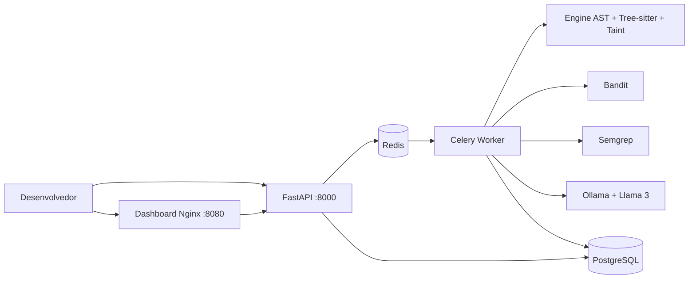

# Plataforma SAST + DevSecOps

Plataforma de **Static Application Security Testing** para código Python,
com análise AST, Tree-sitter, taint intraprocedural, Bandit, Semgrep e
enriquecimento opcional por Ollama/Llama 3.

O projeto é fictício e foi criado para demonstração acadêmica e de
DevSecOps. A amostra em `samples/vulnerable_app` é código próprio,
propositalmente vulnerável e não deve ser exposta como aplicação real.

## Visão geral

1. O desenvolvedor envia um ZIP pela API ou pelo dashboard.
2. A API valida o arquivo, cria um scan e publica uma tarefa no Redis.
3. O worker extrai o ZIP sem executar o código e roda o scanner.
4. Todos os findings são persistidos com fallback determinístico.
5. O scan fica disponível como `DONE`; os achados prioritários podem ser
   enriquecidos progressivamente pelo Ollama.
6. A API e o dashboard exibem findings, métricas, remediações e origem da IA.
7. O Security Gate da GitHub Actions falha para findings `HIGH` ou `CRITICAL`.

## Arquitetura



O diagrama C4 detalhado está em
[docs/arquitetura.md](docs/arquitetura.md).

## Estrutura principal

- `services/api`: FastAPI, upload, consultas, métricas e banco.
- `services/worker`: tarefas Celery, extração segura e persistência.
- `services/engine/sast_engine`: parser, regras, taint, scanner e CLI.
- `services/dashboard`: HTML, JavaScript puro, Chart.js e Nginx.
- `samples/vulnerable_app`: aplicação Flask fictícia vulnerável.
- `tests`: testes unitários e de integração.
- `.github/workflows/sast.yml`: testes, Security Gate e build Docker.

## Como subir

Pré-requisitos: Docker Desktop com Compose.

```bash
docker compose up --build
```

Serviços:

- API: <http://localhost:8000>
- Documentação OpenAPI: <http://localhost:8000/docs>
- Dashboard: <http://localhost:8080>

O arquivo `.env.example` contém as variáveis disponíveis. Copie-o para `.env`
antes de alterar configurações locais:

```bash
copy .env.example .env
```

O modelo pode ser baixado no container Ollama com:

```bash
docker compose exec ollama ollama pull llama3
```

Também existe o script [scripts/pull_model.sh](scripts/pull_model.sh), que
executa `ollama pull llama3` no ambiente apropriado.

## Testes

Localmente:

```bash
python -m pytest -v
```

No container:

```bash
docker compose run --rm api python -m pytest -v
```

O `Makefile` também possui:

```bash
make test
make lint
```

## CLI

Com `PYTHONPATH` apontando para a raiz:

```bash
PYTHONPATH=. python -m services.engine.sast_engine.cli scan services \
  --fail-on HIGH \
  --format json,sarif \
  --output relatorio
```

No container:

```bash
docker compose run --rm api \
  python -m services.engine.sast_engine.cli scan services \
  --fail-on HIGH --format json --output relatorio
```

Saídas:

- `relatorio.json`: findings normalizados.
- `relatorio.sarif`: formato para Code Scanning.
- código `0`: nenhum finding no limiar;
- código `1`: existe finding no limiar;
- código `2`: caminho inválido, inexistente ou sem arquivos Python.

O arquivo `.sast-ignore` é aplicado às regras internas, Bandit, Semgrep e à
normalização final dos resultados.

## Dashboard

No dashboard é possível:

- enviar um ZIP;
- acompanhar o status;
- escolher “Todos os scans” ou um scan específico;
- consultar gráficos de severidade e tendência;
- consultar os cinco arquivos com mais findings críticos;
- filtrar a tabela por severidade;
- expandir a sugestão da IA;
- exportar findings para CSV.

O dashboard usa polling da API a cada cinco segundos enquanto existe
enriquecimento de IA pendente.

## Variáveis relevantes

```env
OLLAMA_URL=http://ollama:11434
OLLAMA_MODEL=llama3
OLLAMA_TIMEOUT=30
SAST_AI_BUDGET=90
SAST_AI_MAX_FINDINGS=5
SAST_CANCEL_PREVIOUS=true
```

Somente findings `CRITICAL` e `HIGH` são candidatos ao LLM. A seleção
prioriza severidade e regras distintas e é limitada por
`SAST_AI_MAX_FINDINGS`. O fallback mantém o CI funcional quando o Ollama não
responde.

## Capturas de tela

As capturas não são versionadas no repositório. Inserir aqui, quando
disponíveis:

```text
[PLACEHOLDER: dashboard com gráficos e tabela de findings]
[PLACEHOLDER: upload e acompanhamento de um scan]
[PLACEHOLDER: GitHub Actions com o Security Gate bloqueado]
```

## Ética e uso autorizado

Use somente código próprio ou código open source para o qual exista autorização
compatível com a licença. Não envie segredos reais, dados pessoais ou código
de terceiros sem permissão. A amostra vulnerável deste projeto é fictícia,
própria e destinada exclusivamente a testes controlados.
