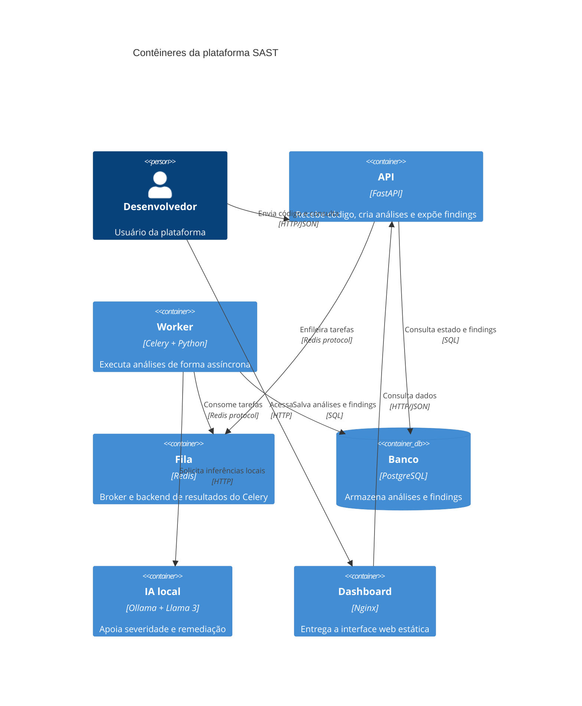

# Arquitetura da plataforma SAST

## Diagrama C4 — Contexto

## Diagrama C4 — Contêiner

## Serviços e fluxo

- **API**: recebe o código-fonte, valida a requisição, enfileira a análise e
  disponibiliza o estado e os findings.
- **Worker**: consome tarefas do Celery, executa o engine com `ast`, Tree-sitter,
  Bandit e Semgrep, e coordena a classificação opcional pela IA local.
- **Redis**: funciona como broker das tarefas e backend de resultados do Celery.
- **PostgreSQL**: persiste análises, findings e seus metadados.
- **Ollama**: executa o Llama 3 localmente para apoiar severidade e remediação,
  sem enviar código para um serviço externo.
- **Dashboard**: entrega o front-end estático via Nginx e consulta a API.

O fluxo assíncrono começa quando a API recebe o código e publica uma tarefa no
Redis. O worker consome essa tarefa, analisa o código, consulta o Ollama quando
necessário e salva os resultados no PostgreSQL. O dashboard consulta a API para
exibir o estado da análise e os findings.
