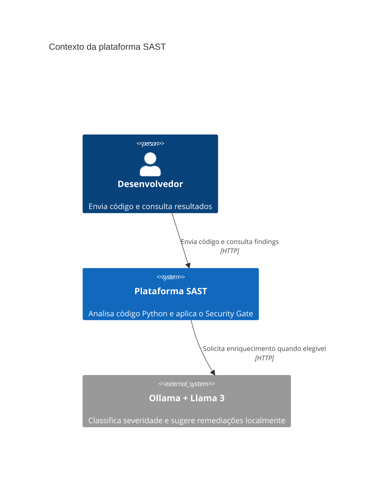
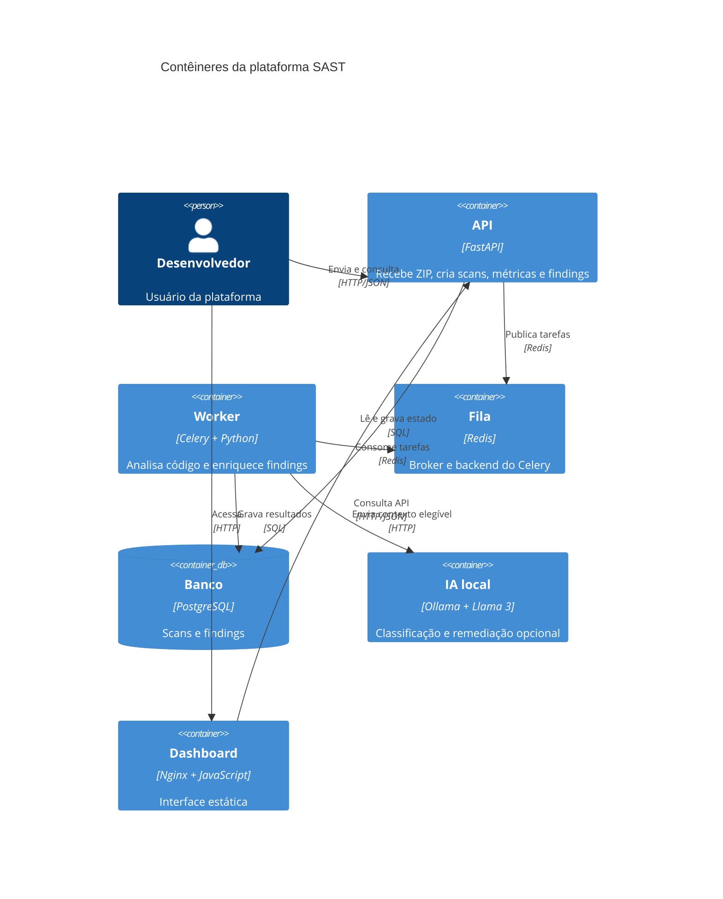

# Arquitetura da plataforma SAST

## Diagrama C4 — Contexto

## Diagrama C4 — Contêiner

## Serviços

- **API:** FastAPI com upload ZIP, validação de tamanho/extensão, proteção
  contra zip-slip, endpoints de scans, findings e métricas.
- **Worker:** Celery com concorrência 2. Extrai o arquivo sem executar o código,
  chama o scanner e persiste resultados.
- **Engine:** parser `ast` e Tree-sitter, regras próprias, taint
  intraprocedural, Bandit e Semgrep.
- **Redis:** broker e backend configurados para Celery.
- **PostgreSQL:** banco principal de produção.
- **Ollama:** serviço local opcional para enriquecimento dos findings mais
  críticos.
- **Dashboard:** HTML/JavaScript puro, Chart.js via CDN e Nginx na porta 8080.

## Fluxo assíncrono

1. `POST /scans` recebe o ZIP e cria o registro `PENDING`.
2. O arquivo é salvo no volume compartilhado e a API publica `run_scan` no
   Redis.
3. A API armazena `celery_task_id`; com `SAST_CANCEL_PREVIOUS=true`, scans
   anteriores ainda ativos ou com IA pendente são cancelados.
4. O worker extrai o ZIP de forma segura e executa a análise.
5. Todos os findings são persistidos com fallback determinístico.
6. O scan passa a `DONE`, permitindo que o dashboard mostre resultados
   imediatamente.
7. Em uma segunda fase, no máximo `SAST_AI_MAX_FINDINGS` achados `CRITICAL` ou
   `HIGH` são enviados ao Ollama, respeitando `SAST_AI_BUDGET`.
8. Cada resposta válida atualiza a linha do finding; falhas mantêm o fallback.
9. O dashboard consulta `/scans`, `/findings` e `/metrics/*` a cada cinco
   segundos enquanto `ia_pendente` estiver ativo.

## Cancelamento e migração

O scan mais recente vence. A API marca scans anteriores como `CANCELLED` e
revoga suas tarefas Celery. O worker relê o status antes de iniciar, antes e
depois de cada chamada de IA e antes de concluir.

Não há Alembic nem histórico de migrações versionadas. Na inicialização, API e
worker executam uma migração leve e idempotente para colunas novas, como
`celery_task_id`, `ia_pendente` e `ia_origem`. Para evolução de schema em
produção, recomenda-se adotar Alembic.
